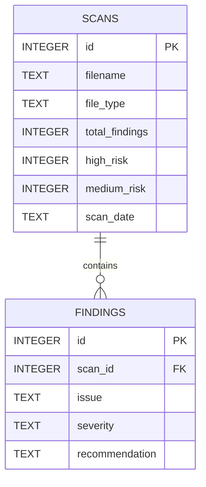

# InfraSentry AI - Database Schema

## Database Technology
SQLite

## Entity Relationship Diagram

## Database Relationship

The scans and findings tables follow a one-to-many
relationship. Each scan can contain multiple security
findings.

The scan_id foreign key references the id of the
scans table.

ON DELETE CASCADE automatically removes associated
findings when a scan record is deleted.

## Database Operations

- Create: Store security scan results.
- Read: Retrieve scan history and findings.
- Update: Modify the displayed filename.
- Delete: Remove scan records and associated findings.
